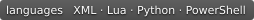

[English](README.md) | [中文](README.zh.md)

<div align="center">

<p align="center"> </p>

# Hello FreeSWITCH

<p align="center">
  
  
  
  
</p>

FreeSWITCH Learning Notes · [Read online](https://cuihairu.github.io/hello-freeswitch/)

</div>

---

A personal collection of FreeSWITCH learning notes, practical takeaways, and development experience, shared from a game developer's perspective. It covers installation and configuration, core concepts, modules, scripts and ESL, and an intelligent customer-service project.

## Knowledge Map

The [knowledge map](https://cuihairu.github.io/hello-freeswitch/knowledge) consolidates the whole site into one page: core concepts, the books and official docs behind it, application scenarios, and common pitfalls, each entry linked back to its source page.

## Local Development

```bash
npm install          # Install dependencies
npm run docs:dev     # Local development
npm run docs:build   # Build to docs/.vitepress/dist
npm run docs:preview # Preview the build locally
```

## License

This work is licensed under the [Creative Commons Attribution 4.0 International (CC BY 4.0)](https://creativecommons.org/licenses/by/4.0/) license.
